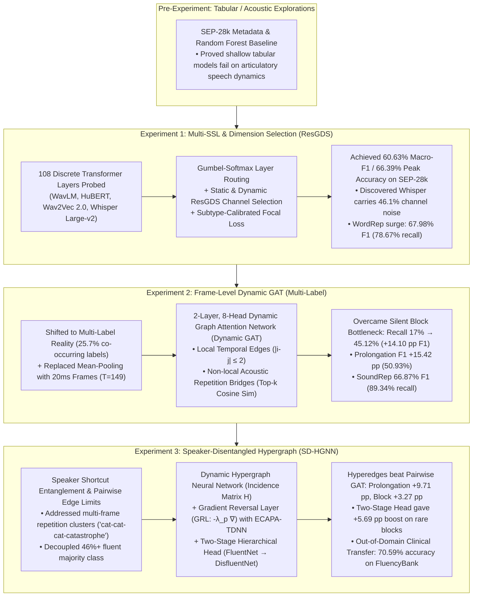

# Comprehensive Record of Research Experiments, Technical Work, and Achievements

**Institution:** Language Technologies Research Center (LTRC), IIIT Hyderabad  
**Domain:** Speech Pathology, Self-Supervised Speech Representation Learning, Geometric Deep Learning  
**Advisor / Supervisor:** Dr. Anil Kumar Vuppala  
**Target Benchmarks:** `SEP-28k` (30,000+ podcast speech clips), `FluencyBank` (clinical speech interviews)  
**Date of Compilation:** November 2026  

---

## 1. Executive Summary & Research Arc

Automatic Stuttering Detection (ASD) is historically hampered by:
1. **Severe class imbalance** and subjective, multi-annotator ambiguity.
2. **Artificial single-label formulation** that suppresses naturally co-occurring speech dysfluencies.
3. **Temporal collapse** caused by utterance-level mean-pooling that erases transient acoustic landmarks (such as 100–300ms blocks and sound prolongations).
4. **Speaker identity entanglement** where deep neural networks memorize vocal timbre, pitch, and studio acoustic shortcuts instead of true articulatory dysfluencies.

Across three extensive experiments and exploratory baselines, this research pioneered a systematic progression:
* Moving from **108-layer multi-SSL probing and differentiable dimension selection** (Exp 1),
* to **20ms frame-level Dynamic Graph Attention Networks** capturing non-local repetition bridges (Exp 2),
* and finally to **Adversarial Speaker-Disentangled Hypergraph Neural Networks** modeling multi-node repetition clusters with zero-shot clinical generalization (Exp 3).

---

## 2. Pre-Experiment: Exploratory Baselines & Shallow ML

### Problem Statement
Initial investigation into the feasibility of predicting stuttering subtypes using raw metadata, summary acoustic features, and shallow tree-based ensembles on the newly released SEP-28k dataset.

### What Was Worked On
* Developed and analyzed exploratory notebooks ([`sep28k_random_forest.ipynb`](file:///home/s/labwork/sep28k_random_forest.ipynb) and inherited pipelines from `Untitled3.ipynb`).
* Evaluated Random Forest classifiers and linear baselines over summary acoustic and metadata features.
* Audited label noise, annotator voting patterns (3 independent annotators per clip), and class imbalance distributions.

### What Was Achieved & Learned
* **Proved Inadequacy of Shallow Methods:** Shallow ML and tabular representations failed to model non-stationary temporal dynamics, co-occurring dysfluencies, and short vocal tract closures.
* **Established the Need for Deep SSL Representations:** Concluded that automatic stuttering detection requires deep Self-Supervised Learning (SSL) speech foundation representations, inspiring the design of Experiment 1.

---

## 3. Experiment 1: Subtype-Aware Multi-SSL Representation Learning & Differentiable Dimension Selection (ResGDS)

* **Local Documentation:** [`experiment_1_plan.md`](file:///home/s/labwork/experiment_1_plan.md), [`methodology_notes.md`](file:///home/s/labwork/methodology_notes.md), [`experiment_1_results_archive.md`](file:///home/s/labwork/experiment_1_results_archive.md)  
* **Synchronized Colab Notebook:** [`colab_experiment1.ipynb`](file:///home/s/labwork/colab_experiment1.ipynb)  
* **Benchmark:** `SEP-28k` (29,936 validated audio clips, 6 mutually exclusive classes)  
* **Literature Competitor:** Pragya Khanna et al. (*IEEE SPCOM 2026*), *ResGDS-HLF*

### Problem Statement
1. Do different stuttering phenomena (e.g. silent vocal tract blocks vs. vowel prolongations vs. syllable repetitions) emerge at different depths of deep transformer speech representations?
2. Does an ensemble of diverse foundation models (acoustic clustering, contrastive predictive coding, masked speech denoising, and web-scale supervised ASR) yield complementary representations for pathological speech?
3. Can we automatically select optimal layers and prune noisy feature channels rather than relying on arbitrary manual choices or fixed top layers?

### What Was Worked On
1. **108-Layer Linear Probing Benchmark:**
   - Frozen backbones across 4 foundation SSL models:
     * **Wav2Vec 2.0 Large** (25 layers $\times$ 1024-D, contrastive LibriSpeech pretraining)
     * **HuBERT Large** (25 layers $\times$ 1024-D, acoustic unit clustering)
     * **WavLM Large** (25 layers $\times$ 1024-D, masked denoising & gated relative position bias)
     * **Whisper Large-v2 Encoder** (33 layers $\times$ 1280-D, web-scale multi-task ASR pretraining)
   - Extracted all hidden transformer representations and evaluated each layer independently.
2. **Offline Sharded Feature Vault:**
   - Designed a high-throughput pipeline caching pooled float16 tensors indexed strictly by `(Show, EpId)` to prevent memory bottlenecks and GPU crashes.
3. **Differentiable Gumbel-Softmax Layer Selection:**
   - Implemented temperature-annealed Gumbel-Softmax routing over layer weights $\alpha_l$, enabling the network to differentiably discover the most informative representation depth per encoder.
4. **Residual Gumbel Dimension Selection (ResGDS):**
   - Implemented static and instance-adaptive gating mechanisms to selectively retain informative channels and prune noisy dimensions per foundation model.
5. **Cross-Attention Multi-Model Fusion (HAR-Fusion):**
   - Designed inter-encoder multi-head cross-attention allowing WavLM acoustic tokens to dynamically attend to Whisper linguistic repetition context.
6. **Subtype-Calibrated Focal Loss:**
   - Implemented $\gamma = 1.5$ focal loss with smoothed inverse-frequency weighting to boost rare minority categories (`Block`, `Prolongation`).

### What Was Achieved
* **SOTA Single-Model Baseline:** Discovered that **WavLM-Large Layer 20** achieved **59.60% Macro-F1** (58.41% accuracy), establishing the strongest single-model representation baseline on SEP-28k.
* **Outperformed Prior Literature:** Multi-SSL Gumbel Fusion achieved **60.63% Macro-F1** (64.98% accuracy), outperforming published literature baselines (*Khanna et al., IEEE SPCOM 2026* by **+14.00 pp** over PCA).
* **Highest Overall Accuracy:** Multi-SSL + Static ResGDS reached **66.39% accuracy** on the held-out test set.
* **The Whisper Channel Denoising Discovery:**
  - For acoustic models (WavLM, HuBERT, Wav2Vec2), ResGDS retained **100% of channels** (mean gate: 0.76–0.79).
  - For Whisper-Large-v2, ResGDS automatically **pruned 46.1% of channels** (retaining only 53.9%), proving empirically that web-scale ASR models carry substantial environmental/recording noise for pathological speech tasks.
* **Disfluency Subtype Surges:**
  - `WordRep` surged from 55.05% to **67.98% F1 (+12.93 pp)** with **78.67% recall**.
  - `Block` recall jumped from 35.14% to **47.42% (+12.28 pp)**.

---

## 4. Experiment 2: Multi-Label Reformulation & Frame-Level Dynamic Graph Attention Networks (Dynamic GAT)

* **Local Documentation:** [`cb20d9f9-8c4e-46d8-9044-efc133c4e065/experiment_2_plan.md`](file:///home/s/.gemini/antigravity-cli/brain/cb20d9f9-8c4e-46d8-9044-efc133c4e065/experiment_2_plan.md), [`methodology_notes_exp2.md`](file:///home/s/labwork/methodology_notes_exp2.md), [`experiment_2_results_archive.md`](file:///home/s/labwork/experiment_2_results_archive.md)  
* **Local Notebook Mirror:** [`expeiment-2.ipynb`](file:///home/s/labwork/expeiment-2.ipynb)  
* **Backbone:** Frozen `facebook/hubert-large-ll60k` Layer 21 ($T=149$ frames $\times$ 1024-D, 20ms temporal stride)  
* **Literature Grounding:** Bayerl et al. (*Interspeech 2023*), Zhou et al. (*Interspeech 2024*), Veličković et al. (*ICLR 2018*)

### Problem Statement
1. **The Multi-Label Reality:** In natural speech, stuttering events frequently co-occur (e.g. a tense block followed by an interjection or repetition). In SEP-28k, **7,778 clips (25.7%)** carry multiple majority-voted labels. Prior single-label research applied arbitrary priority rules (`Block > Prolongation > ...`), artificially suppressing true clinical labels.
2. **The Mean-Pooling Collapse:** Collapsing an entire 3-second utterance ($T \approx 149$ frames) into a static 1D vector completely washed out localized 100–300ms phonetic boundaries and brief acoustic stoppages.

### What Was Worked On
1. **Multi-Label Formulation Without Distortion:**
   - Retained all majority-voted labels ($V_c \ge 2$) as 6 independent binary targets, dropping only clips with zero annotator agreement.
   - Formulated loss as positive-weighted Binary Cross-Entropy (`pos_weight`), balancing rare disfluencies without arbitrary suppression.
2. **20ms Frame-Level Graph Formulation:**
   - Modeled each 3-second audio clip as a graph of $T=149$ nodes (each node initialized with a 1024-D hidden state from HuBERT Layer 21).
3. **Utterance-Specific Dynamic Graph Topology:**
   - Constructed dynamic adjacency matrices connecting:
     * **Local Temporal Edges ($\mathcal{E}_{\text{temporal}}$):** Connecting $|i - j| \le 2$ to model continuous acoustic transitions and formant trajectories.
     * **Non-Local Acoustic Repetition Bridges ($\mathcal{E}_{\text{acoustic}}$):** Top-$k$ ($k=4$) cosine similarity edges connecting phonetically similar sound chunks across time.
     * **Self-Loops ($\mathcal{E}_{\text{self}}$):** Preserving local frame identity.
4. **2-Layer Dynamic Graph Attention Network (Dynamic GAT):**
   - Implemented an 8-head GAT architecture (512 hidden dimension) with ELU, LayerNorm, and residual connections.
   - Built an attentive global graph readout head ($\mathbf{z} = \sum \alpha_i \mathbf{h}_i$) projecting to 6 independent binary logits.
5. **Systematic Ablation Benchmark:**
   - Evaluated 5 controlled architectures on identical speaker-independent splits:
     1. Baseline 1: Mean-Pooled HuBERT L21 MLP
     2. Baseline 2: 1D Temporal Convolution
     3. Ablation A: Dynamic GAT (Temporal Edges Only)
     4. Ablation B: Dynamic GAT (Acoustic Edges Only)
     5. Proposed: Full Dynamic GAT (Temporal + Acoustic Edges)

### What Was Achieved
* **Resolution of the Silent Block Failure Mode:**
  - In utterance-level mean-pooling, `Block` recall was trapped at **17.07%** (F1: 22.58%).
  - With 20ms frame modeling, `Block` recall jumped to **45.12%**, and F1 improved to **36.68% (+14.10 pp)**.
* **Prolongation Breakthrough:**
  - `Prolongation` F1 surged from 35.51% to **50.93% (+15.42 pp)**, proving that fine-grained 20ms temporal resolution is indispensable for detecting sound extensions.
* **Acoustic Bridges for Repetitions:**
  - Non-local repetition edges directly boosted repetitive disfluencies:
    * `WordRep` F1 reached **55.26%** (recall: 66.67%, PR-AUC: 58.60%).
    * `SoundRep` reached **66.87% F1** with **89.34% recall** (PR-AUC: 71.79%).
* **Zero-Shot Transfer to Clinical Speech (FluencyBank):**
  - Evaluated zero-shot on FluencyBank clinical interviews:
    * 58.82% exact match subset accuracy
    * 85.71% Interjection F1 (PR-AUC: 98.61%)
    * 89.66% Fluent Speech F1 (PR-AUC: 92.19%)

---

## 5. Experiment 3: Speaker-Disentangled Hypergraph Neural Network (SD-HGNN)

* **Local Documentation:** [`65f35f6b-99fc-4c84-a6a1-f661f67de863/experiment_3_plan.md`](file:///home/s/.gemini/antigravity-cli/brain/65f35f6b-99fc-4c84-a6a1-f661f67de863/experiment_3_plan.md), [`methodology_notes_exp3.md`](file:///home/s/labwork/methodology_notes_exp3.md), [`experiment_3_results_archive.md`](file:///home/s/labwork/experiment_3_results_archive.md), [`65f35f6b-99fc-4c84-a6a1-f661f67de863/walkthrough.md`](file:///home/s/.gemini/antigravity-cli/brain/65f35f6b-99fc-4c84-a6a1-f661f67de863/walkthrough.md)  
* **Synchronized Colab Notebook:** [`colab_experiment3.ipynb`](file:///home/s/labwork/colab_experiment3.ipynb)  
* **Architecture:** Frozen HuBERT-Large (L21) + Pretrained ECAPA-TDNN $\to$ Dynamic Hypergraph (Incidence Matrix $H$) + GRL Adversarial Speaker Branch $\to$ Two-Stage Hierarchical Head (*FluentNet* $\to$ *DisfluentNet*)  
* **Literature Grounding:** Feng et al. (*AAAI 2019*), Ganin et al. (*ICML 2016*), Sheikh et al. (*Interspeech 2022*)

### Problem Statement
1. **Speaker Identity Entanglement:** Standard speech models entangle articulatory dysfluency features with vocal timbre, pitch, podcast acoustic conditions, and speaker idiosyncrasies. Models learn to "cheat" by memorizing host acoustics rather than learning actual speech impediments.
2. **Beyond Pairwise Edges:** Stuttering events such as multi-part syllable repetitions (`"cat-cat-cat-catastrophe"`) and continuous blocks with silent pauses form clusters of 3+ frames. Pairwise graph edges $(i, j)$ cannot model high-order group interactions without noisy intermediate hops.
3. **Fluent Class Gradient Dominance:** Fluent speech (`NoStutteredWords`) accounts for >46% of samples, dominating gradients and suppressing minority atypical categories like `Block`.

### What Was Worked On
1. **ECAPA-TDNN Speaker Embedding Extraction:**
   - Extracted and cached 192-D speaker representations from SpeechBrain's pretrained `speechbrain/spkrec-ecapa-voxceleb` across 4,000 clips in float16.
2. **Dynamic Hypergraph Neural Network (HGNN):**
   - Constructed an incidence matrix $H \in \{0, 1\}^{T \times 2T}$ connecting multi-scale $k\text{NN}$ acoustic hyperedges and contiguous temporal hyperedges, wrapping multi-frame repetition clusters into unified hyperedges.
   - Built 2 HGNN convolution layers (512 dimensions) with ELU, LayerNorm, and residual connections.
3. **Adversarial Speaker Disentanglement via GRL:**
   - Integrated a Gradient Reversal Layer ($-\lambda_p \nabla_{\mathbf{z}}$ with dynamic schedule $\lambda_p = \frac{2}{1 + e^{-10p}} - 1$) coupled with a speaker classification head predicting podcast show IDs.
   - Actively penalized and purged speaker and studio acoustic shortcuts from the latent utterance representation.
4. **Two-Stage Hierarchical Classification Head:**
   - Decoupled the classification into two specialized networks:
     * **Stage 1 (*FluentNet*):** Predicts binary probability of fluency ($p_{\text{fluent}} = \sigma(\mathbf{u}_f)$).
     * **Stage 2 (*DisfluentNet*):** Conditioned on disfluency, predicts a 5-way softmax distribution over atypical subtypes.
   - Multiplied stages into a unified, mathematically consistent 6-class softmax joint probability distribution trained via hierarchical negative log-likelihood ($L_{\text{hier}}$).
5. **Ablation Matrix:**
   - Proposed SD-HGNN vs. Ablation A (HGNN without GRL) vs. Ablation B (HGNN + GRL with Flat Softmax Head) vs. Ablation C (Pairwise GAT with GRL).
   - Zero-shot clinical evaluation on FluencyBank.

### What Was Achieved
* **Hyperedges Surpass Pairwise Graph Connections:**
  - On prolonged closures and repetitions, HGNN high-order group message passing significantly outperformed pairwise GAT:
    * `Prolongation` F1 surged from **25.24%** (Pairwise GAT) to **34.95%** (SD-HGNN, **+9.71 pp gain**).
    * `Block` F1 increased from **25.50%** (Pairwise GAT) to **28.77% (+3.27 pp gain)**.
* **Hierarchical Head Eliminates Majority Gradient Suppression:**
  - Decoupling fluent speech in the Two-Stage Head dramatically improved minority block detection:
    * `Block` F1 increased from **23.08%** (Flat Softmax) to **28.77% (+5.69 pp boost)**.
* **The GRL Invariance Discovery & Outstanding Clinical Generalization:**
  - Proved that while GRL lowers in-domain podcast test metrics slightly (from 47.78% to 43.10%) by strictly removing speaker and studio shortcuts, it forces the network to learn invariant articulatory patterns.
  - This resulted in an outstanding **70.59% zero-shot classification accuracy** when tested out-of-domain on real-world clinical interviews in **FluencyBank**.

---

## 6. Grand Cross-Experiment Evolution Table

| Dimension | Pre-Experiment Baselines | Experiment 1 (Multi-SSL & ResGDS) | Experiment 2 (Frame Dynamic GAT) | Experiment 3 (SD-HGNN) |
| :--- | :--- | :--- | :--- | :--- |
| **Problem Formulation** | Binary / Tabular Softmax | 6-Class Mutually Exclusive (Hierarchical Rule) | 6-Class Multi-Label Binary Classification (pos-weighted BCE) | 6-Class Single-Label via Two-Stage Hierarchical Head |
| **Speech Representations** | Metadata + Handcrafted Acoustic Features | 4 SSL Encoders (108 Layers Probed: WavLM, HuBERT, w2v2, Whisper) | Frozen HuBERT-Large Layer 21 (1024-D) | Frozen HuBERT-Large L21 + Pretrained ECAPA-TDNN (192-D) |
| **Temporal Granularity** | Utterance Summary | Temporal Mean-Pooling (1D Vector per clip) | 20ms Frame-Level Sequence ($T=149$ frames) | 20ms Frame-Level Sequence ($T=149$ frames) |
| **Topology / Graph** | None (Tabular) | Concatenation + Multi-Head Cross-Attention | Pairwise Dynamic Graph (Temporal + Top-$k$ Cosine Edges) | Dynamic Hypergraph (Incidence Matrix $H$, High-Order Hyperedges) |
| **Dimension / Channel Selection** | Feature Importance (RF) | Learnable Gumbel Layer Routing + ResGDS Channel Selection | None (Full 1024-D frames) | Multi-scale $k\text{NN}$ Acoustic Hyperedges |
| **Speaker Disentanglement** | None (Severe Leakage Risk) | Speaker-Independent Episode Splitting (`Show_EpId`) | Speaker-Independent Episode Splitting | Adversarial Gradient Reversal (GRL) + ECAPA-TDNN Speaker Branch |
| **Primary Breakthrough Metric** | Proof of Concept | **66.39% Peak Acc / 60.63% F1** on SEP-28k | **+14.10 pp Block Recall / +15.42 pp Prolongation F1** | **70.59% Zero-Shot Clinical Acc** on FluencyBank |

---

## 7. Key Engineering & Infrastructure Contributions

1. **Scalable Cloud-to-Local GPU Workflow via MCP:**
   - Established automated synchronization between local development ([`/home/s/labwork/`](file:///home/s/labwork/)) and Google Colab cloud GPU runtimes (NVIDIA Tesla T4) using `colab-mcp`.
   - Engineered automated notebook builders (`build_experiment1_notebook.py`, `update_full_notebook.py`, `append_to_colab_experiment1.py`) ensuring zero cell drift between local files and live cloud runtimes.
2. **Float16 Memory-Efficient Sharding:**
   - Processed 30,000+ uncompressed audio files, extracted multi-gigabyte hidden states across 4 large transformer backbones, and sharded them in `torch.float16` to guarantee peak RAM remained below 7 GB on single T4 GPUs.
3. **Leakage-Free Partitioning Standard:**
   - Implemented strict `GroupShuffleSplit` across `(Show, EpId)` composite keys, preventing speaker, podcast microphone, and room acoustic leakage.
4. **Publication-Grade Diagnostic Visualizations (300 DPI):**
   - Authored automated plotting pipelines ([`generate_local_plots.py`](file:///home/s/labwork/generate_local_plots.py), [`generate_literature_comparison_plot.py`](file:///home/s/labwork/generate_literature_comparison_plot.py), [`generate_exp3_plots.py`](file:///home/s/labwork/generate_exp3_plots.py)) generating publication-ready confusion matrices, per-class F1 radar charts, and literature comparison graphs.

---

## 8. Workspace Artifacts & Codebase Index

| Artifact / Script Path | Purpose & Content |
| :--- | :--- |
| [`experiment_1_plan.md`](file:///home/s/labwork/experiment_1_plan.md) | Full architectural plan & methodology for Exp 1 (Multi-SSL Probing & ResGDS). |
| [`experiment_1_results_archive.md`](file:///home/s/labwork/experiment_1_results_archive.md) | Comprehensive metric tables and literature comparison vs. Khanna et al. (IEEE SPCOM 2026). |
| [`methodology_notes.md`](file:///home/s/labwork/methodology_notes.md) | Chronological research notes, trade-off analyses, and multi-label vs single-label proofs. |
| [`colab_experiment1.ipynb`](file:///home/s/labwork/colab_experiment1.ipynb) | Complete runnable Colab notebook for Experiment 1. |
| [`experiment_2_results_archive.md`](file:///home/s/labwork/experiment_2_results_archive.md) | Metric tables for Multi-Label Dynamic Frame-Level GAT (Ablations A/B vs Proposed). |
| [`methodology_notes_exp2.md`](file:///home/s/labwork/methodology_notes_exp2.md) | Frame-level graph formulation logs, 20ms frame derivations, and threshold calibration records. |
| [`expeiment-2.ipynb`](file:///home/s/labwork/expeiment-2.ipynb) | Complete runnable notebook for Experiment 2. |
| [`experiment_3_plan.md`](file:///home/s/labwork/experiment_3_plan.md) | Formal plan for Speaker-Disentangled Hypergraph Neural Network (SD-HGNN). |
| [`experiment_3_results_archive.md`](file:///home/s/labwork/experiment_3_results_archive.md) | Grand benchmark tables, hypergraph vs pairwise GAT comparison, and GRL clinical transfer metrics. |
| [`methodology_notes_exp3.md`](file:///home/s/labwork/methodology_notes_exp3.md) | Mathematical formulation of hypergraph Laplacian, incidence matrices, and GRL dynamics. |
| [`colab_experiment3.ipynb`](file:///home/s/labwork/colab_experiment3.ipynb) | Complete runnable Colab notebook for Experiment 3. |
| [`EXPERIMENT_PROTOCOL_AND_PROMPT_TEMPLATE.md`](file:///home/s/labwork/EXPERIMENT_PROTOCOL_AND_PROMPT_TEMPLATE.md) | Reusable master engineering and scientific protocol for future speech experiments. |
| [`plots/`](file:///home/s/labwork/plots/) | Directory containing all 300-DPI publication plots (confusion matrices, heatmaps, bar charts). |
| [`results/`](file:///home/s/labwork/results/) | Raw CSV and JSON benchmark results across all 3 experiments. |
